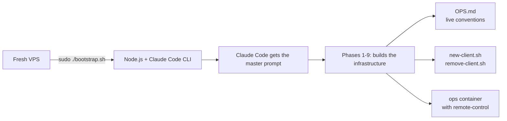
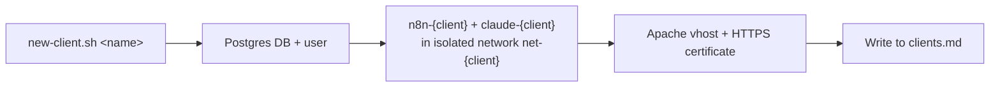
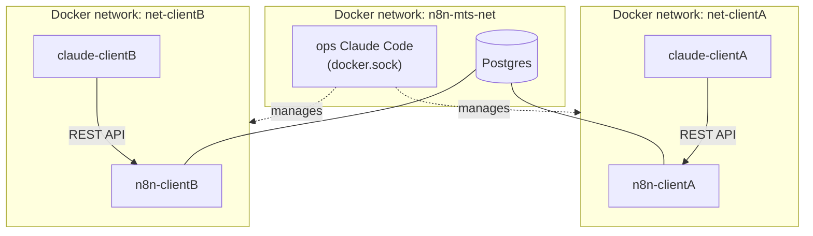

# n8n multi-tenant starter


[](LICENSE)

🇬🇧 English · [🇨🇿 Čeština](README.md)

A starting point for self-hosted multi-tenant n8n hosting on a VPS,
where the architecture (Apache, Postgres, Docker networks, isolated
per-client pairs) is built by Claude Code from a single prompt.

Author: **David Helcl**

## Contents

- [How it works](#how-it-works)
- [Architecture](#architecture)
- [Quick start](#quick-start)
- [Repository structure](#repository-structure)
- [Usage tracking and flat fees](#usage-tracking-and-flat-fees)
- [Project status](#project-status)
- [Security notes](#security-notes)
- [License](#license)

## How it works

Installation has two distinct phases, worth telling apart:

**1. One-time install** — `bootstrap.sh` installs Claude Code on a
fresh VPS and hands it a detailed prompt (phases 1–9). Claude Code
uses it to build the whole server, generating among other things
`scripts/new-client.sh`, `scripts/remove-client.sh`, and the live
operational conventions in `OPS.md`. This phase happens once, at
first deployment.



**2. Day-to-day operation** — creating and removing clients no longer
goes through an AI prompt, but through the generated **bash script**
`new-client.sh`. It's deterministic: the same client name always
produces the same structured result (only the concrete values — port,
password, keys — differ each time).



You can run the script either directly (`./scripts/new-client.sh
client-name`), or conversationally — by messaging the ops Claude Code
assistant (say, from your phone): *"Set up a new client 'acme-corp'."*
In that case an LLM is in the loop again, interpreting the message and
— per the conventions in `OPS.md` — expected to just run the same
script. In the vast majority of cases it will, but unlike running the
script directly, that isn't mathematically guaranteed.

## Architecture

Two-layer model:

- **Ops layer** (1× per server) — Claude Code with access to
  `docker.sock`, manages the whole server: creates/removes clients,
  configures Apache/Postgres. Never touches a specific client's data
  directly.
- **Client layer** (1× pair per client) — `n8n-{client}` +
  `claude-{client}` in their own isolated Docker network
  `net-{client}`. The client's Claude Code only talks to its
  neighbor's n8n REST API, has no `docker.sock` and no access to any
  other client.
- **Apps** (optional, any number per client) — a client's own web
  apps, managed by the same `claude-{client}` (`./scripts/new-app.sh
  client app`). An app figures out at runtime how to start itself
  (its own `start.sh`, or Apache with PHP automatically otherwise),
  and can be given its own SSH deploy access for external tools
  (typically an n8n workflow) — off until you explicitly turn it on.



Detailed diagram: [`docs/architecture.en.html`](docs/architecture.en.html)
(an HTML file, open it in a browser). Step-by-step written guide:
[`docs/guide.en.md`](docs/guide.en.md).

## Quick start

On a fresh VPS (Debian 12 or Ubuntu 24.04, min. 4 vCPU / 8 GB RAM),
logged in as root:

```bash
git clone https://github.com/p33cz/n8n-multi-tenant-starter.git /opt/n8n-mts
cd /opt/n8n-mts
chmod +x bootstrap.sh
sudo ./bootstrap.sh
```

The script asks for a domain and an Anthropic API token, verifies DNS,
and launches Claude Code, which builds the rest itself from the
embedded prompt. Detailed requirements and a step-by-step walkthrough:
[`docs/guide.en.md`](docs/guide.en.md).

## Repository structure

```
bootstrap.sh              — runs on a fresh VPS, installs Claude Code
                             and hands it control to build the whole
                             infrastructure
CLAUDE.md                  — orientation for Claude Code (or anyone)
                              starting work on this repo — what it is,
                              where to find things, what to watch for
                              before committing
docs/navod.md              — written step-by-step guide (Czech)
docs/guide.en.md           — written step-by-step guide (English)
docs/architektura.html     — architecture diagram (Czech)
docs/architecture.en.html  — architecture diagram (English)
scripts/                   — provisioning scripts: new-client.sh, remove-client.sh,
                              new-app.sh, remove-app.sh, enable-app-ssh.sh,
                              usage-report.sh, n8n-apikey.sh, lib.sh (shared functions)
templates/                 — docker-compose.yml and Apache vhost templates
                              for clients and apps (envsubst, secrets kept out of git)
docker/                    — Dockerfiles: ops container, claude-agent (per client),
                              app-runtime (apps — Node/Python, or Apache+PHP)
ops/                       — docker-compose for the ops layer itself
pricing.conf                — AI model pricing for usage estimates (see below)
```

`scripts/`, `templates/`, and `docker/` are a working, finished
implementation — not just a description. They came into being by
Claude Code generating them once from the master prompt in
`bootstrap.sh` (phases 5–7) on a real server, getting verified
repeatedly through live operation, and being committed back here.
`bootstrap.sh` itself can still build the infrastructure from scratch
on any other, fresh VPS, following the same prompt — this version in
`scripts/`/`templates/`/`docker/` is at the same time a reference,
tested example of the result.

`clients.md`, `apps.md`, and `OPS.md`, on the other hand, hold the
live state of a specific deployment (real client names, the domain in
links) and are deliberately in `.gitignore` — they don't belong in the
repo. `OPS.md` is created on the server during install (phase 5 in
`bootstrap.sh`), alongside the root `CLAUDE.md`, not instead of it —
`CLAUDE.md` stays generic and committed, because Claude Code loads it
automatically at the start of every session in this directory.
`CLAUDE.md` pulls in `OPS.md` itself (if it exists on a given
deployment) via the `@OPS.md` line.

## Usage tracking and flat fees

All `claude-{client}` containers share one `ANTHROPIC_API_KEY`, so
Anthropic bills usage as a whole, not per client. If clients pay a
flat fee meant to cover AI costs, usage needs to be tracked outside
Anthropic's own billing — phase 7 in `bootstrap.sh` therefore has
Claude Code generate:

- `clients/{client}/usage.log` — token usage for that client, based on
  transcripts of its Claude Code sessions
- `pricing.conf` — current model pricing (per 1M tokens), easy to
  update
- `scripts/usage-report.sh` — a usage and estimated-cost overview per
  client, with a warning when a client approaches its flat-fee limit

This is only a rough estimate (based on local transcripts, not
official Anthropic billing) — use the Anthropic Console for exact
figures.

## Project status

A starter kit, not an audited/battle-tested production platform — but
`scripts/`, `templates/`, and `docker/` in this repo have been through
repeated real-world deployment (creating and removing clients and
apps, generating n8n API keys, certificates), and the bugs it hit are
fixed right here. Before deploying it yourself, it's recommended to:
- go through the security notes in [`docs/guide.en.md`](docs/guide.en.md)
- verify behavior after a `reboot` (n8n/Postgres/ops container
  auto-restart)
- watch [Issues](https://github.com/p33cz/n8n-multi-tenant-starter/issues)
  for known limitations and work in progress

## Security notes

Only the ops container may have `docker.sock` mounted — that's the
core of the isolation between clients. Full explanation of the risks
and trade-offs:
[`docs/guide.en.md` → Security note](docs/guide.en.md#security-note).

## License

[MIT](LICENSE) — © 2026 David Helcl. The code is free to use, modify,
and redistribute; the license only requires keeping the copyright
notice.
